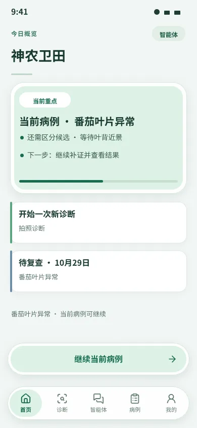
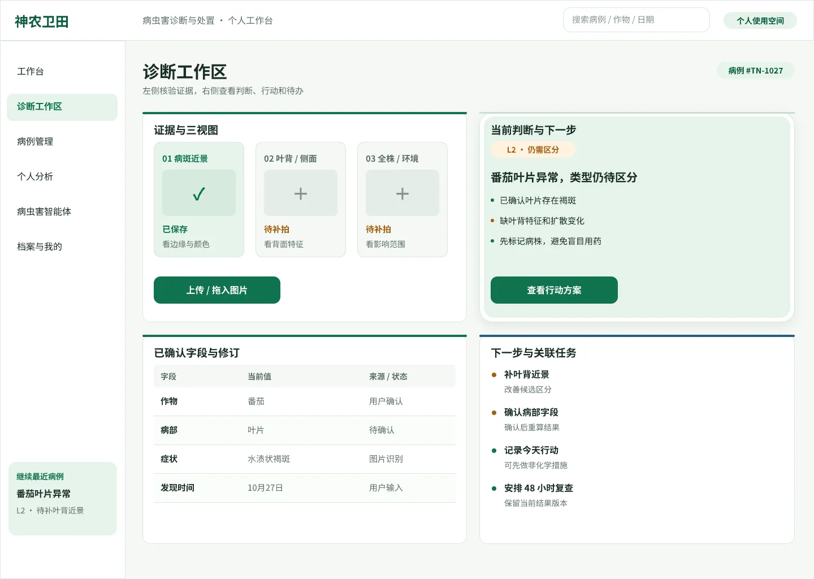

# 神农卫田病虫害识别智能体

本仓库保存消费端病虫害识别产品的设计基线与可编辑原型。PC 与移动端采用同一诊断服务逻辑；智能诊断由 Personal Agent 推进，农业问答保留独立会话入口。

## 已完成的设计资料

- [消费级产品升级 PRD V2.4](docs/神农卫田消费级产品升级PRD_V2.4.md)
- [双智能体原型设计说明 V1.0](docs/神农卫田双智能体原型设计说明_V1.0.md)
- [可编辑原型 `.pen`](prototype/神农卫田2.0-完整原型.pen)
- [43 张画板的 GitHub 图片预览](prototype/preview/README.md) · [离线 HTML 画廊](prototype/preview/index.html)

| 移动端首页 | PC 诊断工作区 |
|---|---|
|  |  |

`.pen` 及图片快照生成于 2026-11-05，包含移动端 35 张、PC 端 8 张画板。双智能体设计说明于 2026-11-06 更新，画板尚未同步其中的全部交互调整。HTML 文件用于下载后离线浏览；GitHub 仓库页面可直接查看图片预览。

## 分支用途

- `main`：当前产品方案和原型设计基线。
- `feature/model-capability`：从 `main` 建立，用于神农大模型 API 接入、Personal Agent 模型能力实现与评估；分支内另有范围说明。

当前神农 API 可用调用次数不足以完成约 200—300 条评估集及多轮病例测试。正式能力结论应在获得足够额度后形成，现阶段不据小样本决定是否引入其他通用模型。
