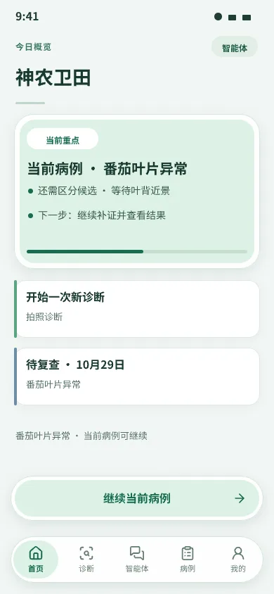
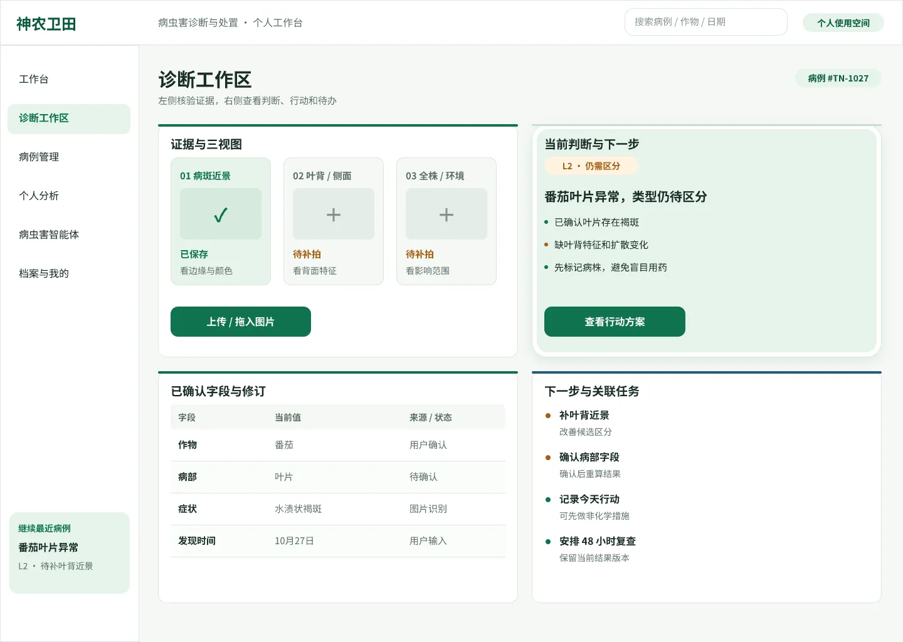

# 神农卫田 2.0 原型预览

共 43 张画板（移动端 35 张、PC 端 8 张）。图片可直接在 GitHub 打开；下载本目录后可离线打开 [HTML 画廊](index.html)。

`.pen` 原型快照生成于 2026-11-05；双智能体设计说明更新于 2026-11-06，画板尚未同步后者的全部调整。

## 移动端

- [P01 首页｜进行中](images/R03oNB.webp)
- [P02 三视图取证](images/PqI3M.webp)
- [P02 状态｜需重拍](images/Z43K4B.webp)
- [P03 证据确认](images/g8ADY.webp)
- [P04 补充提问](images/c8lZQ.webp)
- [P04 状态｜语音回显](images/s87SI.webp)
- [诊断中｜同一请求](images/YyWF7.webp)
- [M01 病虫害智能体](images/Bo03c.webp)
- [P05 结果｜L2 主方案](images/gabnI.webp)
- [P05 展开｜依据与候选](images/WFp9w.webp)
- [P05 结果｜L1 状态](images/rt5wV.webp)
- [P05 结果｜L3 状态](images/k6gJ3.webp)
- [P06 行动计划](images/WUqX0.webp)
- [P07 用药核验｜待补条件](images/YlH7j.webp)
- [P07 状态｜禁止加量](images/CPJL5.webp)
- [P08 执行记录](images/Dguhk.webp)
- [P09 复查计划](images/pJAxo.webp)
- [P10 复查比较](images/zBCd4.webp)
- [P11 病例列表](images/Qru2f.webp)
- [P11 病例时间线](images/ThAIB.webp)
- [P11 状态｜删除确认](images/C5idHm.webp)
- [P12 紧急安全覆盖](images/ByI7p.webp)
- [P13 我的](images/USE7b.webp)
- [P13 权限与数据](images/ceORg.webp)
- [异常状态｜弱网恢复](images/q4lZzg.webp)
- [异常状态｜模型超时](images/yH3Ep.webp)
- [视觉方向 B｜P05 L2](images/gDkVo.webp)
- [视觉方向 C｜P05 L2](images/HJLJZ.webp)
- [P01 状态｜首次无病例](images/RidLE.webp)
- [P07 状态｜计算器结构](images/lF17x.webp)
- [P10 状态｜复查加重](images/wPpI5.webp)
- [P11 状态｜分享预览](images/o19cSU.webp)
- [P11 状态｜结束确认](images/KiUbm.webp)
- [P04 状态｜任务澄清](images/v03sKr.webp)
- [P04 状态｜麦克风被拒绝](images/S7jJbo.webp)

## PC 端

- [D01 PC 首页](images/c7nV7.webp)
- [D02 PC 诊断工作区](images/rAWwE.webp)
- [D03 PC 病例列表与详情](images/xSOjJ.webp)
- [D04 PC 个人数据分析](images/jQCky.webp)
- [D05 PC 档案与我的](images/vcZKv.webp)
- [D04 状态｜无数据](images/v3V206.webp)
- [D04 状态｜接口错误](images/G0Y9yz.webp)
- [D06 病虫害智能体](images/h368Ld.webp)

## 代表画板

| 移动端首页 | PC 诊断工作区 |
|---|---|
|  |  |
